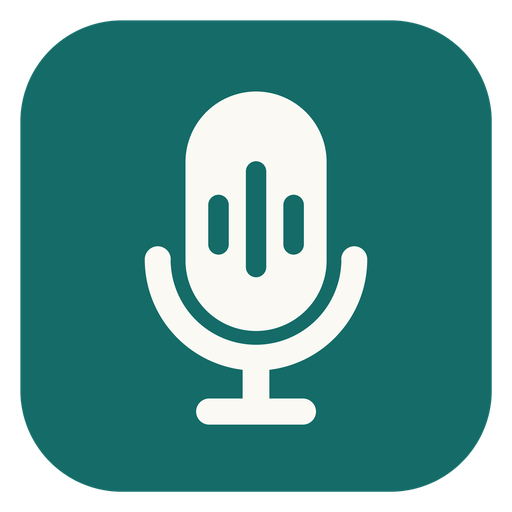

  

<h1 align="center">Sonivane</h1>

<b>Turn your Android phone into a clean, noise-free microphone for your PC or Mac.</b>

---

## What is it?

Sonivane lets you use your phone as a microphone for your computer. Talk into your phone, and your voice shows up on the computer as a normal microphone that Discord, Valorant, Zoom, OBS and other apps can use.

On the way, an AI cleans up the sound. Keyboard clicks, fans, the TV in the next room and street noise are removed, and your voice stays.

It was built for gamers who don't have a good headset mic, but anyone can use it.

## Why use it?

- **No new microphone to buy.** Your phone's mic is already good. Sonivane makes it usable on a computer.
- **Removes background noise.** The noise remover is an AI model that runs on your own computer. Your voice never goes to the internet.
- **Even volume.** Quiet voices are lifted and loud ones are brought down, so friends don't have to turn you up or down.
- **Made for games.** It's light on the processor, so it can run next to a game.
- **Works over Wi-Fi.** No cable needed.
- **Private.** The connection between your phone and computer is encrypted, and nothing is stored or uploaded.

## How to use it

1. **Install Sonivane on your computer.** Windows or Mac, from the [Releases page](../../releases/latest).
2. **Install the app on your phone.** Download the Android file (`.apk`) from the same page and open it. Android may ask you to allow installs from this source.
3. **Put both on the same Wi-Fi.**
4. **Pair them.** On the computer, open the **Phone** tab and show the QR code. On the phone, scan it. You only do this once.
5. **Tell your games and chat apps to use it.** In Discord or your game, choose the Sonivane microphone as your input.

### One extra step: a virtual microphone

Windows and Mac don't let a program create a new microphone by itself, so Sonivane sends your sound to a free "virtual cable" that your apps then see as a microphone.

- **Windows:** install the free [VB-Cable](https://vb-audio.com/Cable/). In Discord, choose **CABLE Output** as your microphone.
- **Mac:** install the free [BlackHole](https://existential.audio/blackhole/).

In Sonivane, open the **Output** tab and pick the cable. Sonivane only offers virtual cables there, so your voice never plays through your speakers by accident.

> Tip: on Windows you can rename "CABLE Output" to "Sonivane" in the Windows sound settings so it looks nicer in Discord.

## What you can change

- **Noise removal:** *Efficient* (lightest), *Balanced*, *Quality* (cleanest, uses more of the processor) or *Off*.
- **Preset:** *Natural*, *Discord* or *Podcast*, which tune how your voice sounds.
- **Hear my voice:** off by default. Turn it on if you want to listen to yourself and check how you sound.
- **Hold to hear original:** hold the button to hear your voice without the cleaning, so you can compare.

## Good to know

- **Windows shows a warning on first run** ("Windows protected your PC", or on Mac "unidentified developer"). The app isn't code-signed yet because that costs money. Choose *More info → Run anyway* on Windows, or right-click the app and choose *Open* on Mac.
- **Wi-Fi only for now.** A USB-cable mode is planned but not working yet.
- **You need a virtual cable** (see above). Sonivane doesn't include its own audio driver yet.
- **Android only** for the phone. iPhone isn't supported.

## For developers

Sonivane is made of:

- a desktop app written in **Rust** with **Tauri** (`desktop/`),
- an Android app written in **Kotlin** (`android/`),
- audio sent as **Opus** over encrypted UDP, with a jitter buffer and a voice chain (filters, volume levelling, noise removal, EQ, compressor, limiter).

More detail is in [ARCHITECTURE.md](ARCHITECTURE.md).

## Credits

Noise removal uses [DPDFNet](https://github.com/ceva-ip/DPDFNet) from Ceva (Apache-2.0 license), run through [tract](https://github.com/sonos/tract).
